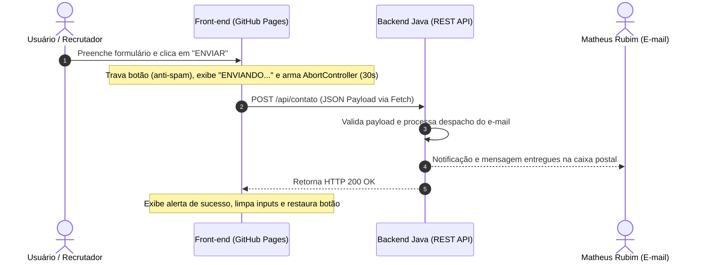

# 🌐 Matheus Rubim - Portfólio Front-end


<div align="center">


<p align="center">
  <strong>Interface desenvolvida em Vanilla Web Technologies, hospedada no GitHub Pages e integrada à API Java.</strong>
</p>

[Acessar Portfólio Online](https://rubimze.github.io/portfolio-site/)

</div>

---

## 📌 Visão Geral

Este repositório contém o código-fonte da interface web do meu portfólio profissional, Desenvolvedor Backend com foco no ecossistema Java / Spring Boot e mais de 5 anos de experiência na área de TI.

A aplicação foi planejada para operar de forma pública e contínua no **GitHub Pages**:

- **Front-end Nativo:** Desenvolvido em HTML5, CSS3 e JavaScript (ES6+), sem uso de bibliotecas ou frameworks.
- **Integração com Backend em Java:** O formulário de contato utiliza uma API REST desenvolvida em Java dedicada ao envio seguro de mensagens.
- **Portfólio:** Exibe projetos práticos que integram tecnologias, como o **Gerador de QR Code** com armazenamento em nuvem via **Bucket Amazon S3** e outros projetos.

---

## ⚙️ Arquitetura e Fluxo de Integração

### Fluxo da API de Contato (Java Backend)

O envio de mensagens do formulário de contato ocorre de forma assíncrona, desacoplando o cliente estático hospedado no GitHub Pages do microsserviço de backend:



---

---

## 🚀 Tecnologias Utilizadas

| Tecnologia | Categoria | Finalidade no Projeto |
| :--- | :--- | :--- |
| **HTML5** | Estruturação | Marcação semântica (`<header>`, `<nav>`, `<main>`, `<section>`, `<footer>`), acessibilidade ARIA e SEO. |
| **CSS3** | Estilização | Design system baseado em Variáveis CSS, Flexbox, CSS Grid, Glassmorphism (`backdrop-filter`) e `@keyframes`. |
| **JavaScript ES6+** | Lógica de Cliente | Manipulação de DOM, `requestAnimationFrame` (60 FPS no scroll), `AbortController`, suporte a arraste e gestão em `localStorage`. |
| **Java (Backend)** | Integração de API | API REST responsável pelo recebimento e processamento das mensagens do formulário de contato. |
| **Bootstrap Icons** | Iconografia | Ícones vetoriais integrados via CDN. |
| **Google Fonts** | Tipografia | Família tipográfica *Poppins* carregada de forma otimizada via `preconnect`. |

---

## 🛠️ Funcionalidades e Diferenciais

### 1. Tema Dinâmico (Dark/Light) & Anti-FOUC
- **Prevenção de FOUC (Flash of Unstyled Content):** Uma rotina síncrona no `<head>` intercepta a pintura inicial da tela, aplicando o atributo `data-theme="dark"` imediatamente caso essa tenha sido a preferência salva pelo usuário:
  ```html
  <script>
      if (localStorage.getItem('tema') === 'dark') {
          document.documentElement.setAttribute('data-theme', 'dark');
      }
  </script>
  ```
- **Variáveis CSS Centralizadas:** A troca de tema no botão modifica variáveis nativas de cores, sombras e superfícies translúcidas em tempo real.
- **Persistência de Estado:** Salva a escolha do usuário no `localStorage` do navegador.

### 2. Cabeçalho Inteligente (Smart Sticky Header)
- **Otimização com `requestAnimationFrame` (rAF):** O monitoramento da rolagem é executado em sincronia com a GPU do navegador, evitando gargalos de renderização e perda de frames.
- **Comportamento Reativo:**
  - Adiciona sombra (`header-com-sombra`) a partir de `50px` de deslocamento.
  - Oculta o cabeçalho ao rolar para baixo e o reexibe ao rolar para cima, aprimorando a leitura em telas menores.
- **Scroll Padding:** Configurado com `scroll-padding-top: 100px` para impedir que o cabeçalho fixo cubra os títulos das seções ao navegar.

### 3. Carrosséis Bidirecionais com Auto-Scroll e Scrubbing
Implementado nativamente em [menu.js](file:///c:/Users/p0168934/Documents/Matheus%20Pessoal/portfolio-site/menu.js) para as seções de **Projetos** e **Certificados**:
- **Auto-Scroll:** Movimentação contínua que inverte a direção ao alcançar as extremidades.
- **Pausa Inteligente & Acessibilidade:** O carrossel pausa automaticamente ao passar o mouse, ao tocar na tela ou ao navegar com teclado via `Tab`.
- **Drag-to-Scroll (Mouse):** Suporte a clique e arraste com o mouse para rolagem horizontal, prevenindo a abertura acidental de links durante o movimento.
- **Barra de Scrubbing Interativa:** O usuário pode clicar ou arrastar diretamente na barra de rolagem inferior para navegar pela lista.

### 4. Formulário Resiliente com Anti-Spam e AbortController
A rotina em [contato.js](file:///c:/Users/p0168934/Documents/Matheus%20Pessoal/portfolio-site/contato.js) trata a integração de rede com práticas defensivas:
- **Proteção Contra SPAM e Cliques Múltiplos:** Ao enviar, o botão é bloqueado (`disabled = true`), o cursor muda para `not-allowed`, a opacidade é reduzida e o rótulo é alterado para `"ENVIANDO..."`.
- **Mecanismo Anti-Timeout (AbortController):** Como servidores em nuvem gratuita podem entrar em estado de dormência (*cold start*), um temporizador de 30 segundos com `AbortController` evita travamentos:
  ```javascript
  const controller = new AbortController();
  const timeoutId = setTimeout(() => controller.abort(), 30000);
  ```
- **Tratamento de Erros:**
  - `AbortError`: Informa que o servidor estava acordando e orienta a reenviar.
  - Alertas visuais flutuantes (`msg-sucesso` e `msg-erro`) com descarte automático em 8 segundos.

### 5. Mobile-First e Dynamic Viewport
- **Ajuste Dinâmico no Mobile:** O menu lateral adota a unidade `100dvh` (*Dynamic Viewport Height*), impedindo cortes visuais provocados pelas barras dinâmicas do Safari (iOS) e Chrome (Android).
- **Overflow:** O contêiner `.overflow-wrapper` isola vazamentos laterais mantendo o `position: sticky` do cabeçalho.

### 6. Identidade Visual Glassmorphism & Blobs Animados
- **Superfícies de Vidro:** Efeito fosco com `backdrop-filter: blur(12px)` e bordas translúcidas.
- **Blobs em Animação:** Fundo flutuantes via `@keyframes blob-float` que garantem dinamismo visual sem comprometer a leitura.

---

## 📂 Estrutura de Arquivos

```text
portfolio-site/
│
├── index.html              # Estrutura, marcação e SEO
├── style.css               # Design system, variáveis de tema, glassmorphism e media queries
├── contato.js              # Integração do formulário, validação, AbortController e AJAX
├── menu.js                 # Dark mode, sticky header e carrossel interativo
│
├── docs/                   # Documentos oficiais para download
│   └── Curriculo - Matheus Rubim de Sousa - DevJava.pdf
│
└── images/                 # Ativos de mídia, logotipos e capturas de tela
    ├── Logo cabeçalho.png
    ├── QRCode.png
    ├── imagem-cadastro.png
    ├── imagem-dslist.png
    └── certificados/       # Comprovantes em PDF e imagens de certificados
```

---

## 🌐 Hospedagem e Publicação (GitHub Pages)

O portfólio é publicado através do **GitHub Pages**:

- **URL de Produção:** [https://rubimze.github.io/portfolio-site/](https://rubimze.github.io/portfolio-site/)
- **Deploy Automático:** Qualquer alteração enviada para a branch `main` do repositório é automaticamente publicada e propagada na CDN global do GitHub.
- **Zero Build Step:** Por ser construído com tecnologias web nativas, dispensa ferramentas de transpilação ou build (`npm build`, `vite`, `webpack`), carregando os arquivos diretamente no navegador.

---

## 🔌 Integração com a API de Contato

A interface se comunica com o backend em **Java** através da seguinte rota REST:

### Endpoint: `POST /api/contato`

- **URL:** `https://portfolio-api-kg2u.onrender.com/api/contato`
- **Cabeçalhos:** `Content-Type: application/json`

#### Formato do Payload JSON
```json
{
  "nome": "João da Silva",
  "email": "joao.silva@exemplo.com",
  "celular": "+55 31 99999-9999",
  "mensagem": "Olá Matheus, gostaria de conversar sobre oportunidades na área de desenvolvimento Java."
}
```

#### Tratamento de Respostas da API
| Código / Evento | Cenário | Resposta da Interface |
| :--- | :--- | :--- |
| `200 OK` / `201 Created` | Mensagem gravada e encaminhada com sucesso | Notificação de sucesso verde, formulário limpo (`reset()`) e botão restaurado. |
| `4xx` / `5xx` | Erro de validação ou indisponibilidade no servidor | Notificação de erro e campos preservados para reenvio. |
| `AbortError` (30s) | Tempo limite atingido (*cold start* do servidor) | Notificação orientando o usuário a clicar novamente para enviar. |

---

## 💼 Projetos em Destaque no Portfólio

### Gerador de QR Code (Java + Amazon S3)
- **Aplicação Online:** [qrcode-front-rust.vercel.app](https://qrcode-front-rust.vercel.app/)
- **Tecnologias:** Java 21, Spring Boot, **Amazon AWS (S3 Bucket)**, Docker.
- **Diferencial de Arquitetura:**
  - Processa a geração do QR Code em memória via microsserviço Java.
  - Realiza o upload automatizado do arquivo PNG diretamente para um **Bucket no Amazon S3**, garantindo armazenamento seguro, durabilidade e escalabilidade.
  - Retorna a URL pública/CDN do S3 para renderização e download direto na aplicação cliente.

### Cadastro Clientes API
- **Tecnologias:** Java 21, Spring Boot, JPA / Hibernate, H2 Database, Maven, Swagger / OpenAPI.
- **Funcionalidades:** CRUD de clientes com persistência relacional, validação de integridade e documentação interativa de rotas.

### DSList
- **Tecnologias:** Java 21, Spring Boot, Spring Data JPA, Maven.
- **Funcionalidades:** API RESTful para consulta, catalogação e reordenação de coleções de jogos com manipulação de índices de lista.

---

## 💼 Experiência Profissional & Certificações

### Histórico Profissional
- **Especialista em Governança Google Workspace @ RW3 Tecnologia (TJMG)** *(Abr 2026 – Presente)*  
  Desenvolvimento de automações em JavaScript para provisionamento de usuários, sincronismo de identidades entre Active Directory (AD) e Google Cloud, e auditoria de políticas de segurança.
- **Analista Técnico N2 @ Bagy-Tray (LWSA)** *(Nov 2021 – Abr 2026)*  
  Debugging avançado com Chrome DevTools, análise de payloads HTTP/REST, consultas complexas em SQL para investigação de causa raiz e sustentação de integrações de microsserviços.
- **Auxiliar de TI @ CNH Industrial Brasil** *(Ago 2019 – Jul 2021)*  
  Administração de servidores, governança de acessos e sustentação de infraestrutura.

### Formação Acadêmica & Certificações
- **Graduação em Análise e Desenvolvimento de Sistemas** — Centro Universitário UNA (2.030 hrs)
- **Networking Essentials** — Cisco Networking Academy (70 hrs)
- **Java Completo e Programação Orientada a Objetos** — Udemy / Prof. Nélio Alves (54 hrs)
- **Bootcamp Backend Java & AWS** — Digital Innovation One (DIO) / CI&T (54 hrs)
- **Programação Web I & II (HTML, CSS e JS)** — PRODABEL (46 hrs)
- **Imersão GoogleDay** — EJEF / TJMG (13 hrs)

---

## 📊 Boas Práticas e Qualidade de Software

- **HTML Semântico:** Estrutura que favorece a indexação de motores de busca (SEO) e o consumo por tecnologias assistivas (A11y).
- **Zero Third-Party Bloat:** Ausência de bibliotecas JS desnecessárias, garentindo velocidade de carregamento.
- **Carregamento Otimizado:** Uso da `defer` para não bloquear o parsing inicial do HTML.
- **Carregamento de Imagens Sob Demanda:** Implementação de loading="lazy" para deferir o download de imagens fora do viewport inicial (off-screen), combinada com fetchpriority="high" no logotipo principal para otimizar o tempo de renderização do Largest Contentful Paint (LCP).

---

## 👤 Autor

**Matheus Rubim de Sousa**  
*Desenvolvedor Backend Java | Analista de TI*

- **LinkedIn:** [linkedin.com/in/matheusrubim](https://www.linkedin.com/in/matheusrubim/)
- **GitHub:** [@Rubimze](https://github.com/Rubimze)
- **E-mail:** [contatorubimze@gmail.com](mailto:contatorubimze@gmail.com)
- **Localização:** Belo Horizonte, MG — Brasil

---

<div align="center">
  <sub>Desenvolvido por Matheus Rubim.</sub>
</div>
